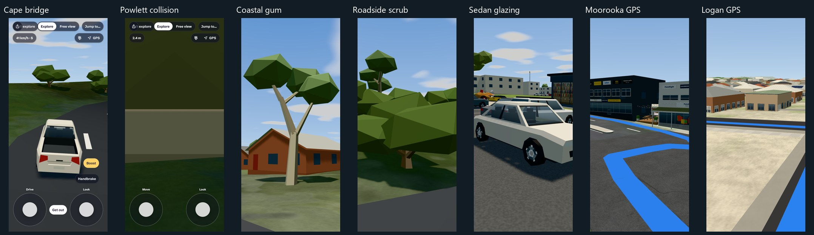

# Inverloch v45 public beta playtest

28 November 2026 AEDT. Build `c5aa354a8838` served the #373 v45 beta. Its road map was byte-identical to the release candidate. The sole renderer byte change was the beta map filename. Production still used v42 at the time of the checks. [Beta deployment](https://github.com/Ashley-Pettit/3dModels/pull/378) · [Owner’s playtest request](https://github.com/Ashley-Pettit/3dModels/pull/373#issuecomment-7230292212)

## Pixel 7 input and GPS

Two trusted Chrome touch contacts held Move and Look together on the connected phone. Both stayed active when the first route appeared. Releasing Look kept Move active. Both released normally and accepted a fresh pair with the GPS route active. Zero cancellations or page exceptions across the three betas.

| Page and destination | Selection to GPS activation | Longest nearby animation callback gap | Hold after selection |
|---|---:|---:|---:|
| Inverloch beta, Tennis Club & Oval | 40.2 ms | 53.1 ms | 31.22 s |
| Moorooka beta, Yeronga Park Café | 135.4 ms | 765.4 ms | 5.25 s |
| Logan beta, The plane | 25.1 ms | 86.2 ms | 5.10 s |
| Moorooka production, Yeronga Park Café | 20.5 ms | 78.8 ms | 5.19 s |

Inverloch maintained the pair for 312 touch events across the first 1,345 m route. Moorooka beta recorded 576 ms and 715 ms main-thread tasks around route activation. Both Moorooka runs used the v80 renderer and reached the same destination from positions that yielded 744 m and 767 m routes. A single comparison captures total scene and main-thread activity around the user interaction. It cannot attribute those pauses to ribbon assembly. [Phone measurements](touch.json) · [Production control](touch-production.json) · [Matched physical v44/v45 sustained drives](../pixel7/)

## Phone-sized feature checks

BenLaptop Chrome ran with a 393 × 851 touch viewport. We first loaded the public beta untouched, then used observation hooks, staged actors and accelerated session time to isolate each behavior.

- At Medium, sampled grades on Lees Road were −1.34% and +2.48%, Hillside −17.56% and western Cape +12.12%. A forward touch drove across the 19.52 m Cape bridge and all 44 tyre samples stayed 1.43–9.19 cm above its deck.
- On foot the Powlett house stopped forward input. The walking and driving controls both stopped at a staged sedan. The 11 Norman driveway sample stayed open.
- A borrowed car remained in place at 29 and 31 simulated minutes while watched. Moving the camera away allowed it to return by 31.5 minutes. Its home pose, collision and all four parked LODs returned, and the driven slot became available.
- High showed the Marion Court gum, Surf Parade roadside scrub and an A’Beckett sedan with visible seats through depth-tested panes at opacity 0.34.
- The first Beaudesert Road GPS route in Moorooka (2.77 km) and Kingston Road route in Logan (9.37 km) both showed the blue line at the start and through bends. Stopping each GPS route removed the geometry and cleared navigation state. The measured mesh assembly took 1.2 and 2.6 ms respectively on the laptop.
