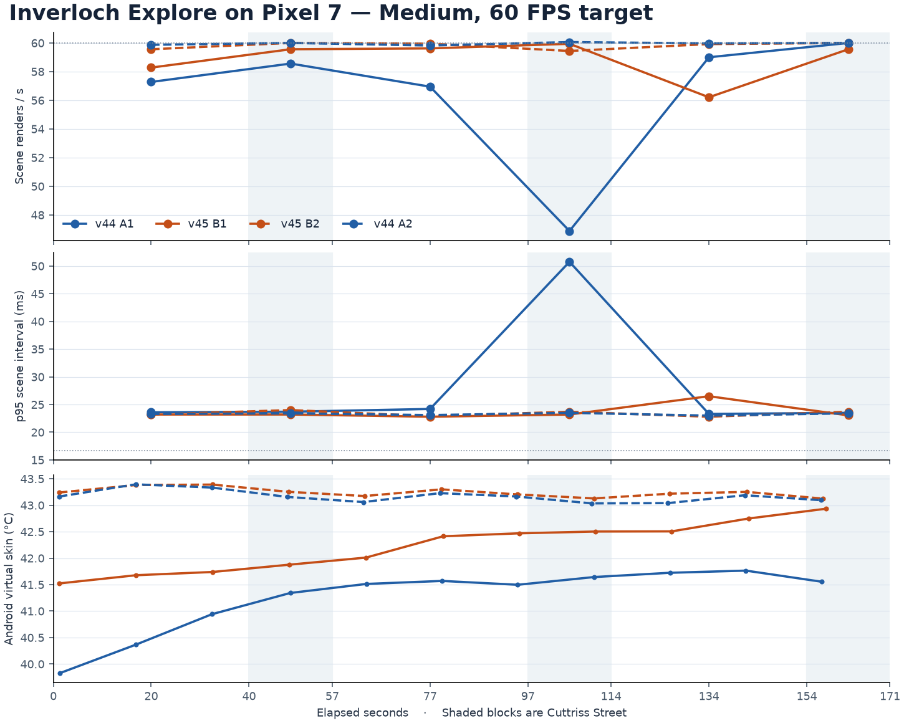

# Inverloch Explore physical Pixel 7 benchmark

The warm v45 and v44 passes both reached 43.4°C virtual skin and moderate Android thermal status. V45 was within 0.14 scene renders/s and 0.10 ms p95 of v44. The first v45 pass fell to 56.21 FPS on its final A’Beckett segment. The warmer repeat held 59.56–59.92 FPS on the same street.

- v44 recorded 57.0–59.9 scene renders/s overall with p95 23.2–24.2 ms. Its final repeated street windows recorded p95 23.0–23.5 ms.
- v45 recorded 58.5–59.8 scene renders/s overall with p95 23.3 ms. Its final repeated street windows recorded p95 22.8–26.5 ms.

## Full-drive measurements

| Run | Build | Replay distance (m) | Scene render FPS | Scene interval p50 / p95 / p99 (ms) | rAF callbacks/s | Compositor FPS median (samples) | Virtual skin °C | Max thermal status | Page exceptions |
|---|---|---:|---:|---:|---:|---:|---:|---:|---:|
| A1 | v44 | 1,899.6 | 57.04 | 16.4 / 24.2 / 49.1 | 82.69 | 88.8 (14) | 39.8 → 41.5 (peak 41.8) | 1 | 0 |
| B1 | v45 | 1,899.6 | 58.55 | 16.6 / 23.3 / 32.0 | 86.02 | 90.2 (13) | 41.5 → 42.9 (peak 42.9) | 1 | 0 |
| B2 | v45 | 1,899.6 | 59.78 | 16.6 / 23.3 / 24.6 | 89.42 | 90.3 (13) | 43.1 → 43.1 (peak 43.4) | 2 | 0 |
| A2 | v44 | 1,899.6 | 59.92 | 17.6 / 23.2 / 24.4 | 90.08 | 90.3 (13) | 43.1 → 43.0 (peak 43.4) | 2 | 0 |

## Same-street repeat, first → last cycle

| Run | Street | Scene render FPS | p95 interval (ms) | p99 interval (ms) | Median draw calls |
|---|---|---:|---:|---:|---:|
| A1 | A’Beckett | 57.28 → 59.00 | 23.60 → 23.30 | 35.77 → 28.50 | 170 → 179 |
| A1 | Cuttriss | 58.56 → 60.00 | 23.70 → 23.50 | 43.07 → 24.50 | 119 → 119 |
| B1 | A’Beckett | 58.28 → 56.21 | 23.20 → 26.50 | 38.05 → 37.58 | 177 → 185 |
| B1 | Cuttriss | 59.56 → 59.56 | 23.20 → 23.04 | 25.34 → 25.14 | 129 → 129 |
| B2 | A’Beckett | 59.56 → 59.92 | 23.20 → 22.80 | 26.80 → 24.10 | 177 → 187 |
| B2 | Cuttriss | 60.00 → 60.00 | 24.00 → 23.70 | 24.60 → 24.60 | 129 → 129 |
| A2 | A’Beckett | 59.87 → 59.97 | 23.30 → 23.00 | 24.60 → 24.10 | 170 → 179 |
| A2 | Cuttriss | 60.00 → 60.00 | 23.40 → 23.41 | 24.54 → 24.20 | 120 → 119 |

## Device and method

Physical Pixel 7 on BenLaptop over ADB USB reverse, Tensor G2, ANGLE (ARM, Mali-G710, OpenGL ES 3.2), Android 17, Chrome 157.0.8103.78 and portrait physical 1080×2400. Browser viewport 411×758 CSS px and DPR 2.625, with a 534×985 initial native buffer. The app selected Medium with a 60 FPS target. The phone was USB-powered with battery saver off and no viewport, GPU or refresh-rate override.

Each run repeated the same 40 s A’Beckett and 17 s Cuttriss occupied-ute camera clips three times for 171 continuous seconds. The shared original v44 motion trace SHA-256 was d7bdf2112e9ed0ed273a87d0f48a6e7d53483b4f91c7b993250132c3895fd6dd. Distances sum the recorded road traces and exclude resets between clips. The native ute and camera replayed the same positions with a fixed clear-weather epoch. This measures renderer load on matching views. The separate native driving records cover steering, collision and navigation. Street measurements exclude 0.5 s at each end of the clips. Full-drive measurements include resets.

The local release fixture inserted the same measurement, replay and preference hooks and served a local copy of Three.js, following the existing motion comparison. The phone reached the pinned builds over loopback. Thermal startup temperatures varied as the handset warmed.

- v44 Explore HTML SHA-256 f33e2ce3bce3e24381d422f6a4180bbc2cee55b443c43af4279bed885a73e7bf, model SHA-256 ffaddec4afec92b659246acd01798568350d76dcaaa3c9cc0078cbe1c9de8525.
- v45 Explore HTML SHA-256 bbddbd2e1394f10f38f7af8994ac436f92391a33d1a0ee18b4cfd98acdfb8da8, model SHA-256 64d2d38caa4aff7c36ec6fb790c840be69a8b2e8767f6156fca7a5a10e97ce45.

Scene render FPS counts returns of native main-scene WebGL renderer calls. rAF counts browser callbacks. Android SurfaceFlinger independently sampled the Chrome content layer's presentation timestamps in short history windows. Its cadence includes compositor submissions that may repeat the same WebGL image. Thermal readings use current Android HAL sensors sampled about every 15 seconds from setup into the drive. Android status 1 is light and 2 is moderate. The A1 sampler initially missed Android's wrapped layer names. Its available presentation readings were recovered mid-run and saved separately.

[Per-run and per-street frame intervals](summary.json).
